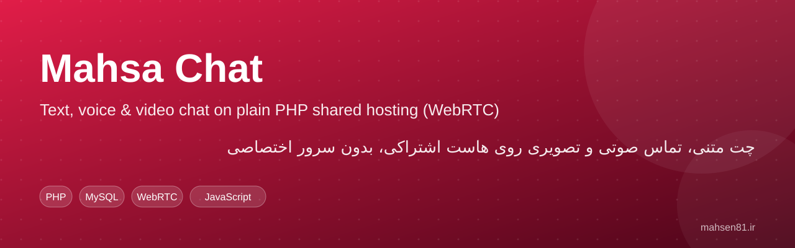

<!-- gen:header -->
<p align="center"></p>

<h1 align="center">Mahsa Chat</h1>
<p align="center"><b>چت متنی، تماس صوتی و تصویری روی هاست اشتراکی، بدون سرور اختصاصی</b><br><i>Text, voice & video chat on plain PHP shared hosting (WebRTC)</i></p>
<p align="center">   </p>

<div dir="rtl">

## ✨ امکانات

- شناسه‌ی شش‌رقمی برای هر کاربر
- تماس همتابه‌همتا با WebRTC
- بدون Node، سوکت یا VPS
- نصب گرافیکی روی cPanel

</div>

## 🚀 Quick start

```bash
Upload to public_html → open /install.php → delete install.php
```

---

<!-- gen:docs -->
## 📚 مستندات کامل · Full documentation

# مهسا — گفتگوی متنی، صوتی و تصویری روی PHP

سیستم چت یک‌به‌یک برای هاست اشتراکی سی‌پنل. هر کس حساب می‌سازد، یک شناسهٔ شش‌رقمی می‌گیرد، و با دادن آن شناسه می‌تواند متن بفرستد یا تماس صوتی/تصویری بگیرد.

رسانهٔ صدا و تصویر روی مرورگر با WebRTC رد و بدل می‌شود (همتا‌به‌همتا). سرور PHP فقط پیام‌ها و سیگنال اتصال را در MySQL نگه می‌دارد؛ به Node، سوکت دائمی یا VPS نیاز نیست.

## نصب روی سی‌پنل

1. در سی‌پنل از **MySQL Database Wizard** یک دیتابیس، کاربر و رمز بسازید و کاربر را به دیتابیس وصل کنید.
2. همهٔ فایل‌های این پوشه را در `public_html` (یا یک زیرپوشه مثل `public_html/chat`) آپلود کنید. فایل `config.php` محلی را آپلود نکنید.
3. در مرورگر `https://دامنه-شما/install.php` را باز کنید، نوع **MySQL** را نگه دارید و اطلاعات دیتابیس را وارد کنید.
4. بعد از پیام موفقیت، فایل `install.php` را از هاست حذف کنید.
5. در سی‌پنل **SSL** را روشن کنید (Let's Encrypt). بدون HTTPS مرورگر اجازهٔ دوربین و میکروفون را نمی‌دهد.
6. با `register.php` حساب بسازید، شناسه را کپی کنید و به طرف مقابل بدهید.

PHP ۷٫۴ یا بالاتر و `pdo_mysql` لازم است. برای تست روی رایانه می‌توانید در نصب، SQLite را انتخاب کنید.

## استفاده

- شناسهٔ خود را از ستون راست کپی کنید.
- شناسهٔ طرف مقابل را وارد کنید و «باز کردن گفتگو» را بزنید.
- از همان صفحه پیام بفرستید یا تماس صوتی/تصویری بگیرید.

## محدودیت هاست اشتراکی

- تماس مستقیم بین دو مرورگر است. اگر هر دو پشت NAT سخت باشند ممکن است صدا/تصویر وصل نشود؛ در آن حالت به سرور TURN جدا نیاز است که روی سی‌پنل اشتراکی اجرا نمی‌شود.
- سرورهای STUN عمومی در بعضی شبکه‌ها فیلتر می‌شوند. اگر زنگ می‌خورد ولی تصویر نمی‌آید، شبکه را عوض کنید یا TURN اضافه کنید.
- این نسخه برای گفتگوی دو نفره طراحی شده، نه اتاق گروهی.

## اجرای محلی

```bash
php -S localhost:8080
```

سپس `http://localhost:8080/install.php` — localhost از نظر مرورگر امن است و دوربین کار می‌کند.

---

<p align="center">ساخته‌شده توسط <a href="https://mahsen81.ir"><b>محسن جباره‌اصل</b></a> — برنامه‌نویسی، طراحی سایت، ربات و هوش مصنوعی<br>
Built by <a href="https://mahsen81.ir">Mohsen Jabbareh-Asl</a> · ⭐ اگر مفید بود، ستاره بدهید · Need a custom version? <a href="https://mahsen81.ir">Get in touch</a></p>
